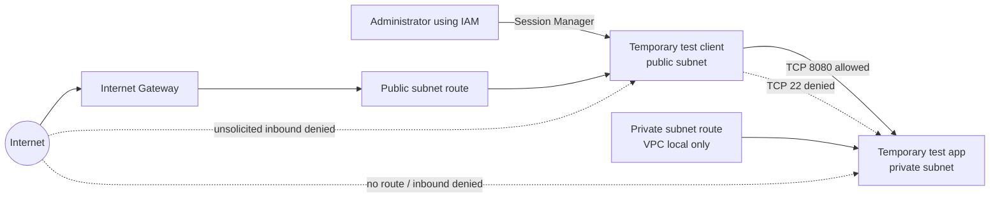

# AWS Network Security Lab Series

**Purpose:** Extend the existing Terraform VPC lab into a sequence of controlled exercises in network segmentation, traffic authorization, reachability analysis, and network observability.

**Historical status note:** The planning status below reflects the report's initial draft and is superseded by the dated progress updates later in this document. The latest recorded AWS-side work is Objective 2 route inspection and Objective 3 security-group configuration/inspection; workload traffic has not been tested.

**Starting point reviewed:** At the beginning of the lab, `main.tf` defined one VPC (`10.20.0.0/16`), one subnet (`10.20.1.0/24`) in `eu-north-1a`, one explicitly associated route table, and no internet route or workload. Later dated updates in this report record the route and security-group work that followed.

## Learning outcomes

By the end of the series, be able to:

1. Draw the intended network paths before deploying them.
2. Explain how routes, security groups, and network ACLs affect a flow.
3. Distinguish configured reachability from observed traffic.
4. Use VPC Flow Logs and Reachability Analyzer as evidence sources, including their limits.
5. Make a Terraform change, inspect its plan, document the result, and clean up lab resources safely.

## Lab guardrails and assumptions

- Use a dedicated learning account or sandbox, a single AWS Region, and non-production data.
- Keep the first implementation small: one VPC, one public subnet, one private subnet, and at most two temporary test instances. A single Availability Zone is sufficient for the initial segmentation exercise; add a second only when studying availability-zone behavior.
- Avoid inbound SSH from the internet. If instances are needed, prefer Systems Manager Session Manager with the required instance profile and network connectivity.
- Do not add a NAT Gateway or AWS Network Firewall in the first pass. Add them only as separate cost and egress-control exercises.
- Preserve a recoverable copy of the existing state before any state migration or destructive change. Do not commit state files, credentials, or plan files containing sensitive values.
- Agree on a maximum spend, a shutdown/cleanup time, and who is authorized to create or delete resources before deployment.

## Pre-execution constraints and risks to check

| Constraint | Why it matters | Pre-execution check / mitigation |
|---|---|---|
| Account permissions | Terraform needs create/read/delete permissions for the selected VPC, EC2, logging, IAM, and analysis resources. | Confirm the caller identity and the minimum permissions available. Avoid using long-lived access keys. |
| Budget and metering | EC2, NAT Gateways, Network Firewall, log ingestion/storage, and some analysis features can incur charges. | Review current pricing for the chosen Region, set a spend limit or budget alert, and omit optional paid components until needed. |
| Existing local state | The directory has local state and a backup. Replacing or losing state can cause drift or unsafe plans. | Make a protected copy before changes. Inspect plans carefully; do not run `apply` if Terraform proposes unexpected replacement or destruction. |
| Region and AZ availability | The current configuration pins `eu-north-1` and `eu-north-1a`. | Confirm the account can use the Region/AZ and that any selected instance type is available there. |
| Address-space overlap | CIDRs may collide with a VPN, home network, or other VPC, confusing routes and later connectivity. | Record all lab CIDRs and check them against existing connected networks before extending the design. |
| Session Manager prerequisites | Session Manager requires a managed instance, correct IAM permissions, and a network path to Systems Manager endpoints. | Decide whether the lab uses outbound internet access or VPC endpoints; verify the chosen path and endpoint costs. |
| Flow log delivery | Flow logs need a correctly configured destination and permissions; records may be delayed or incomplete. | Choose CloudWatch Logs or S3, define retention/access controls, and plan to generate known traffic before querying. |
| Analyzer scope | Reachability Analyzer models supported network configuration; it does not send packets. | Use it alongside, not instead of, controlled traffic observations. Record unsupported components or filters. |
| Cleanup | Leftover instances, gateways, logs, and endpoints can continue to incur costs. | Keep a resource inventory and a teardown checklist; preserve only the evidence needed for the report. |

AWS notes that Flow Logs do not capture all IP traffic and are not a real-time stream. Reachability Analyzer evaluates a model of the configured path rather than sending packets. Treat both as bounded evidence sources, not complete packet-level proof. [Flow Logs limitations](https://docs.aws.amazon.com/vpc/latest/userguide/flow-logs-limitations.html) · [How Reachability Analyzer works](https://docs.aws.amazon.com/vpc/latest/reachability/how-reachability-analyzer-works.html)

## Objectives and planned tasks

### Objective 1 — Define the intended traffic policy

**Question:** Which components should communicate, on which protocol and port, and which paths should be impossible?

**Planned tasks:**

- Draw a small topology with public and private subnet roles, route tables, test endpoints, and logging destination.
- Write an allow/deny matrix before editing Terraform. For example: administrator to workload only through Session Manager; public subnet to private workload only on the chosen test port; private workload has no unsolicited inbound path from the internet.
- Record the expected source, destination, protocol, port, and reason for every allowed flow.

**Tools:** Diagram tool or paper; Terraform configuration; AWS VPC documentation.

**Evidence to retain:** Topology diagram, CIDR plan, traffic matrix, and threat assumptions.

#### Working draft for this lab

This is a proposed policy for review, not a deployed design. It keeps the first build small and makes each intended path testable.

**Topology:** One VPC with one public subnet and one private application subnet in `eu-north-1a`. A temporary client instance sits in the public subnet with a public IPv4 address; a temporary application instance sits in the private subnet without one. The public subnet has an Internet Gateway route for outbound access needed by the client. The private subnet has only the VPC-local route: no Internet Gateway or NAT Gateway route. Neither instance accepts unsolicited inbound connections from the internet. The client uses Systems Manager Session Manager for administration; the application can run a minimal test service without interactive login. Add a second AZ in a later exercise.



**Proposed traffic policy:**

| Source | Destination | Protocol / port | Intended result | Reason / control to examine |
|---|---|---|---|---|
| Administrator | Client instance | Session Manager channel over HTTPS initiated by the managed instance | Allow | IAM-mediated administration; no inbound SSH rule. The instance needs an outbound path to Systems Manager, initially through the public subnet and its public IPv4 address. |
| Administrator | Application instance | Direct SSH or RDP from the internet | Deny | No public address or inbound management rule. Session Manager access to the private instance is deferred until its endpoint/connectivity requirements are designed. |
| Client instance | Application instance | TCP 8080 | Allow | Single intentional application flow, scoped to the client security group as source. |
| Client instance | Application instance | TCP 22 | Deny | Demonstrate least-privilege ingress and collect evidence of a rejected connection attempt. |
| Internet | Client instance | Unsolicited inbound connection | Deny | No inbound security-group rule; public address, if assigned, does not itself grant access. |
| Internet | Application instance | Any direct inbound connection | Deny | Private subnet has no public address assignment or Internet Gateway route; no inbound rule. |
| Application instance | Internet | New outbound connection | Deny for initial lab | Private route table has no default route. This isolates the egress question; do not add NAT until the later egress exercise. |
| Application instance | Client instance | Response to the allowed TCP 8080 flow | Allow | Security groups are stateful; record return-flow behavior separately from new outbound connections. |

**Initial CIDR proposal:** retain the existing VPC `10.20.0.0/16` and current subnet `10.20.1.0/24` as the public subnet; allocate `10.20.2.0/24` for the private application subnet. Check for overlap with existing networks before implementation. These assignments are provisional until the account's other VPCs and connected networks are checked.

**Threat assumptions:**

- The lab should demonstrate that a public route and public IP do not imply that an instance accepts inbound connections; access is separately constrained by security groups.
- The private application should be reachable only through the explicitly authorized client-to-app flow.
- A compromised or misconfigured client should not gain broad access to the private subnet.
- The initial exercise focuses on IPv4, one Region/AZ, and a single TCP application port; it does not establish protection against host compromise, application vulnerabilities, or all IPv6 paths.
- Test instances and test data are disposable. No production data or credentials are placed on them.

**Open design choice before Objective 2:** whether the private application must also be administered through Session Manager during the first build. The simplest first pass leaves the private app without interactive administration and uses user data to start the test service. If private Session Manager access is a learning goal now, add a separate design for Systems Manager VPC endpoints and their cost, IAM, and security-group requirements before deployment.

**Objective 1 progress:** Draft topology, traffic policy, provisional CIDRs, and threat assumptions recorded. Pending user review and overlap check; not yet approved for deployment.

### Objective 2 — Build and inspect subnet segmentation

**Question:** Does the route-table design create the intended separation between public, private, and local-only paths?

**Planned tasks:**

- Extend the current VPC with clearly named public and private subnets. Keep the initial lab to one AZ unless AZ behavior is the subject of the exercise.
- Associate each subnet with an explicit route table. Add only the routes required by the written policy.
- Inspect the Terraform plan before applying. Confirm no unrelated resource is replaced or destroyed.
- Compare the deployed route tables with the diagram and traffic matrix.

**Tools:** Terraform (`fmt`, `validate`, `plan`, and, after review, `apply`); AWS Console or AWS CLI read-only describe commands.

**Evidence to retain:** Reviewed plan, route-table/subnet descriptions, diagram revision, and any deviation from expected routes.

### Objective 3 — Compare security groups and network ACL behavior

**Question:** Which control allows or blocks each test flow, and how do stateful versus stateless rules affect return traffic?

**Planned tasks:**

- Define narrowly scoped security-group rules for a controlled test service. Avoid unrestricted ingress.
- Keep network ACL rules simple at first; add a specific ACL restriction as a separate experiment so its effect can be attributed.
- Generate one allowed flow and one intentionally blocked flow between the test endpoints.
- Change one rule at a time, record the expected result, and compare it with observations.

**Tools:** Terraform; temporary test instances or another controlled endpoint; Session Manager where supported; VPC Flow Logs; AWS security-group/NACL descriptions.

**Evidence to retain:** Rule diffs, test source/destination/port, timestamp, connection result, and relevant log records.

### Objective 4 — Validate configured paths with Reachability Analyzer

**Question:** Does AWS's configuration model find the intended path, and identify the component blocking a prohibited path?

**Planned tasks:**

- Analyze at least one expected reachable path and one expected unreachable path.
- Save the analysis result and explanation codes.
- Compare the modeled result with the rule configuration and the controlled traffic result.

**Tools:** VPC Reachability Analyzer in the AWS Console or supported AWS CLI/API operations; Terraform-managed network resources.

**Evidence to retain:** Source/destination, protocol/port, analysis result, explanation details, time, and comparison to observed traffic.

**Interpretation constraint:** Reachability Analyzer is static configuration analysis. A reachable result does not prove the application is listening or healthy, and unsupported features or filters can limit the analysis.

### Objective 5 — Capture and interpret VPC Flow Logs

**Question:** Can the lab identify accepted and rejected flows, and can each record be associated with a known test?

**Planned tasks:**

- Enable Flow Logs at the chosen scope (subnet or VPC) and send them to a controlled destination with appropriate access and retention.
- Generate low-volume, timestamped allowed and denied traffic.
- Query records by interface, time, source/destination, protocol, port, and action where available.
- Compare log results with the test notes and Reachability Analyzer results.

**Tools:** Terraform; VPC Flow Logs; CloudWatch Logs Insights or S3 query tools depending on destination; AWS CLI/Console.

**Evidence to retain:** Flow Log configuration, destination/retention settings, query text, redacted result excerpts, and test timestamps.

**Interpretation constraint:** Flow Logs aggregate traffic and omit some traffic types. Missing a record alone is not proof that no packet was sent or received.

### Objective 6 — Review egress and private service access

**Question:** Does the private workload need general internet egress, or can a specific AWS service be reached privately?

**Planned tasks:**

- Start with no general egress and list the workload's actual dependencies.
- If required, compare a NAT-based route with a suitable VPC endpoint design as a separate, costed experiment.
- Confirm route and security rules permit only the selected destination paths.
- Record operational tradeoffs, dependencies, and estimated/observed cost.

**Tools:** Terraform; VPC route tables and endpoints; Reachability Analyzer where supported; AWS pricing information; Flow Logs.

**Evidence to retain:** Dependency list, route diff, path results, traffic evidence, and cost notes.

### Objective 7 — Review, clean up, and capture lessons

**Question:** Can the lab be returned to its intended baseline without losing the evidence needed to explain the results?

**Planned tasks:**

- Review the final Terraform plan and resource inventory.
- Preserve sanitized evidence and the final configuration.
- Remove temporary resources according to the approved teardown plan; verify the remaining resources and cost-bearing services.
- Record surprises, unresolved questions, and the next experiment.

**Tools:** Terraform plan/state inspection; AWS CLI/Console read-only inventory; budget/cost views.

**Evidence to retain:** Final plan, cleanup record, remaining-resource inventory, and a concise lessons-learned note.

## Tools inventory

| Tool | Intended use | Notes |
|---|---|---|
| Terraform CLI | Define, format, validate, plan, deploy, and tear down lab infrastructure. | Review every plan; protect state and plan artifacts. |
| AWS CLI | Confirm caller identity and inspect deployed network configuration and logs. | Prefer read-only commands for inspection; use temporary credentials. |
| AWS Console | Review VPC, Flow Logs, Reachability Analyzer, and service configuration. | Console state can differ from local Terraform state if changes are made manually. |
| VPC Flow Logs + CloudWatch Logs Insights or S3 tools | Observe sampled/aggregated network metadata and query known test flows. | Not packet capture; incomplete traffic coverage is possible. |
| Reachability Analyzer | Model whether a specified path is allowed by supported configuration. | Not a data-plane test. |
| Session Manager | Access managed test instances without opening inbound SSH, when prerequisites are met. | Requires IAM and network connectivity to Systems Manager. [AWS Session Manager](https://docs.aws.amazon.com/systems-manager/latest/userguide/session-manager.html) |
| Optional IaC scanner | Check Terraform configuration for common misconfigurations before deployment. | Treat scanner results as prompts for review, not proof that the design is secure. |

## Execution record — fill in during the lab

| Date/time | Objective/task | Change or command carried out | Expected result | Actual result | Evidence location/reference | Status / notes |
|---|---|---|---|---|---|---|
| 2026-10-12 | Objective 1 — define intended policy | Reviewed the current Terraform network and drafted topology, traffic matrix, CIDRs, and threat assumptions in this report. | A reviewable policy with allowed and denied paths exists before infrastructure changes. | Draft recorded; CIDR overlap and user review remain outstanding. | This report, “Objective 1 — Define the intended traffic policy” | Draft complete; awaiting review |
|  |  |  |  |  |  | Not started |
|  |  |  |  |  |  | Not started |
|  |  |  |  |  |  | Not started |
|  |  |  |  |  |  | Not started |

## Post-execution observations and hypothesis analysis

Complete one entry per observation. Separate the observation from its explanation: an observation is what the evidence shows; a hypothesis is one explanation that could account for it.

### Observation entry

**Observation ID:**  
**Objective / task:**  
**Date/time and test conditions:**  
**Observation (what happened, stated without explanation):**  
**Evidence supporting the observation (log excerpt, analysis result, command output, configuration snapshot):**  
**Evidence limitations (missing fields, delay, unsupported feature, measurement uncertainty):**  

**Hypothesis:**  
What specific network behavior or control do you think caused the observation?

**Expected evidence if the hypothesis is supported:**  
Name the result that should be present and where it should appear.

**Evidence found:**  
What evidence supports the hypothesis? What evidence conflicts with it?

**Assessment:**  
- [ ] Supported by the evidence collected
- [ ] Rejected by the evidence collected
- [ ] Inconclusive; additional evidence is needed

**Inference from the evidence:**  
What is the narrowest conclusion justified by the evidence? Avoid extending it beyond the tested source, destination, protocol, port, time, and configuration.

**Alternative interpretations:**  
List other plausible causes. Consider delayed or missing Flow Log records, application/service health, host firewall behavior, DNS, route changes, security-group statefulness, NACL return rules, test-tool behavior, and Reachability Analyzer support limitations.

**Follow-up experiment:**  
Change or measure one factor that would distinguish the main hypothesis from the alternatives.

**Reviewer / date:**  

---

### Observation entry

**Observation ID:**  
**Objective / task:**  
**Date/time and test conditions:**  
**Observation (what happened, stated without explanation):**  
**Evidence supporting the observation:**  
**Evidence limitations:**  

**Hypothesis:**  

**Expected evidence if the hypothesis is supported:**  

**Evidence found:**  

**Assessment:** Supported / Rejected / Inconclusive

**Inference from the evidence:**  

**Alternative interpretations:**  

**Follow-up experiment:**  

**Reviewer / date:**  

## Future analysis questions

- Did actual traffic match the allow/deny matrix? If not, which exact component explains the difference?
- Did Flow Logs, Reachability Analyzer, and the endpoint test agree? If they differed, are they measuring different layers or time windows?
- Is the evidence sufficient to distinguish a network block from a host or application failure?
- Which results depend on a specific Region, AZ, CIDR, endpoint, or unsupported analyzer feature?
- What additional experiment would most efficiently distinguish competing explanations?
- Which controls should be added next: multi-AZ segmentation, controlled egress, VPC endpoints, centralized logging, AWS Network Firewall, or organization-level guardrails?

## Reference material

- [AWS Security Pillar](https://docs.aws.amazon.com/wellarchitected/latest/security-pillar/)
- [VPC Flow Logs basics](https://docs.aws.amazon.com/vpc/latest/userguide/flow-logs-basics.html)
- [VPC Flow Logs limitations](https://docs.aws.amazon.com/vpc/latest/userguide/flow-logs-limitations.html)
- [How Reachability Analyzer works](https://docs.aws.amazon.com/vpc/latest/reachability/how-reachability-analyzer-works.html)
- [Reachability Analyzer troubleshooting](https://docs.aws.amazon.com/vpc/latest/userguide/reachability-analyzer.html)
- [Systems Manager Session Manager](https://docs.aws.amazon.com/systems-manager/latest/userguide/session-manager.html)

## Progress update — 2026-10-12 (Objective 2 complete; Objective 3 in progress)

### Objective 2 — Build and inspect subnet segmentation

**Observed configuration**

- VPC: `[redacted AWS resource ID]`, CIDR `10.20.0.0/16`, Region `eu-north-1`.
- Client subnet: `[redacted AWS resource ID]`, CIDR `10.20.1.0/24`, associated with route table `[redacted AWS resource ID]`.
- Private application subnet: `[redacted AWS resource ID]`, CIDR `10.20.2.0/24`, associated with route table `[redacted AWS resource ID]`.
- Internet gateway: `[redacted AWS resource ID]`.
- Client route table has active VPC-local route `10.20.0.0/16 -> local` and active default route `0.0.0.0/0 -> [redacted AWS resource ID]`.
- Private application route table has only the active VPC-local route `10.20.0.0/16 -> local`.
- Terraform state listed nine managed resources after this objective.

**Inference and limits**

AWS-side route-table inspection supports the conclusion that the client subnet has a configured internet-gateway route and the private application subnet has no default route to an internet gateway or NAT gateway. This verifies route configuration, not actual internet connectivity or endpoint reachability. No EC2 workloads have been launched as part of this evidence.

**Status:** Route segmentation configured and inspected. Objective 2 complete for the planned initial topology.

### Objective 3 — Compare security groups and network ACL behavior

#### Baseline observations

- The VPC's default security group is `[redacted AWS resource ID]`. Its observed inbound rule permits all protocols from members of the same security group; its observed outbound rule permits all IPv4 destinations (`0.0.0.0/0`). It is not being used for the two test roles.
- Default network ACL: `[redacted AWS resource ID]`, associated with both lab subnets. Observed inbound and outbound rule 100 allow all IPv4 (`0.0.0.0/0`); rule 32767 is the deny fallback. The default NACL is intentionally unchanged in this first experiment so that security-group behavior can be isolated.
- Dedicated client security group created: `[redacted AWS resource ID]`, name `terraform-security-lab-client`.
- Dedicated private-app security group created: `[redacted AWS resource ID]`, name `terraform-security-lab-app`.
- Both groups were created by Terraform with `egress = []`. The reviewed plan reported `2 to add, 0 to change, 0 to destroy`; apply reported `2 added, 0 changed, 0 destroyed`.
- AWS CLI inspection subsequently returned `Inbound: []` and `Outbound: []` for both dedicated security groups.

**Hypothesis checked:** The dedicated security groups exist in the intended VPC and begin with no configured ingress or egress permissions.

**Assessment:** Supported by the AWS CLI output. This is configuration evidence only. It does not yet demonstrate that a workload connection succeeds or fails; no test instances or application endpoint have been deployed.

**Control-design note:** Security groups are stateful. Once a permitted connection is initiated, response traffic is allowed by the security-group connection tracking behavior; a separate app egress rule is not normally needed solely for response packets. The client will need an explicit outbound rule for the intended client-to-app TCP flow, and the app will need a matching inbound rule scoped to the client security group. These rules should be added as separate, reviewed Terraform resources.

**Status:** Baseline inventory and dedicated security-group creation complete. Traffic rules and controlled allowed/denied flow tests remain pending.

#### Objective 3 execution log additions

| Date/time (UTC) | Task | Change or command | Actual result | Assessment |
|---|---|---|---|---|
| 2026-10-12 20:05 | Create dedicated client and app security groups | `terraform plan` | `2 to add, 0 to change, 0 to destroy`; both groups showed `egress = []`. | Expected plan; no unrelated changes proposed. |
| 2026-10-12 20:06 | Apply security-group resources | `terraform apply` | User reported: `Apply complete! Resources: 2 added, 0 changed, 0 destroyed.` | Resources created successfully according to Terraform. |
| 2026-10-12 20:07 | Verify actual AWS security-group configuration | `aws ec2 describe-security-groups` filtered to the two group names in VPC `[redacted AWS resource ID]` | Client `[redacted AWS resource ID]`: inbound `[]`, outbound `[]`. App `[redacted AWS resource ID]`: inbound `[]`, outbound `[]`. | AWS-reported configuration matches the intended initial baseline. No data-plane traffic test has been performed. |

**Numbering convention:** Preserve the existing Objective 3 step count across turns. Do not restart step numbering for individual commands; restart only when beginning a new objective.

## Objective 3 — Execution log update (2026-10-12)

### Baseline and dedicated security groups

The default security group in VPC `[redacted AWS resource ID]` was inspected. Its inbound rule allowed all protocols from the same security group, and its outbound rule allowed all IPv4 destinations. The default network ACL `[redacted AWS resource ID]` was also inspected: it was associated with both lab subnets and had allow-all IPv4 inbound/outbound rules with deny-all fallback entries. The default NACL was left unchanged to avoid introducing another variable.

Two dedicated Terraform-managed security groups were created and independently inspected:

- Client: `[redacted AWS resource ID]` (`terraform-security-lab-client`)
- Private app: `[redacted AWS resource ID]` (`terraform-security-lab-app`)

Both were configured with `egress = []`. AWS CLI inspection reported empty inbound and outbound rule arrays for both immediately after creation.

### Step 7 — Application ingress rule

Added and applied `aws_vpc_security_group_ingress_rule.app_from_client`.

- AWS rule ID: `[redacted AWS resource ID]`
- Destination security group: app (`[redacted AWS resource ID]`)
- Source security group: client (`[redacted AWS resource ID]`)
- Protocol/port: TCP/8080
- Description: `Allow TCP 8080 from the lab client`
- Terraform plan: 1 to add, 0 to change, 0 to destroy
- Apply result: 1 added, 0 changed, 0 destroyed

Independent AWS CLI inspection confirmed the deployed rule. The output showed `IsEgress: false`, TCP port 8080, the client source group, and no IPv4 CIDR source.

### Step 8 — Verify application ingress

The AWS `describe-security-group-rules` result matched the intended ingress policy. This supports the conclusion that the app security group has a narrow inbound permission for TCP 8080 from the client security group. It does not establish that a connection succeeds or that an application is listening.

### Step 9 — Client egress rule

Added and applied `aws_vpc_security_group_egress_rule.client_to_app`.

- Destination security group: app (`[redacted AWS resource ID]`)
- Source security group: client (`[redacted AWS resource ID]`)
- Protocol/port: TCP/8080
- Description: `Allow client to connect to app on TCP 8080`
- Terraform plan: 1 to add, 0 to change, 0 to destroy
- Apply result: 1 added, 0 changed, 0 destroyed

### Step 10 — Verify client egress

Independent AWS CLI inspection returned:

- Rule ID: `[redacted AWS resource ID]`
- `IsEgress: true`
- Protocol/port: TCP/8080
- Destination security group: `[redacted AWS resource ID]`
- IPv4 CIDR: `null`

The egress rule matches the intended narrow policy. Together, the verified ingress and egress rules express permission for the client security group to initiate TCP/8080 traffic to the app security group. Security groups are stateful, so response traffic for an allowed connection is permitted by connection tracking; a separate reverse-direction rule is not needed solely for response packets.

### Objective 3 status and limits

**Configured and independently verified:** dedicated client/app security groups, no broad CIDR rules in the two newly added permissions, app ingress TCP/8080 from client group, and client egress TCP/8080 to app group.

**Not yet demonstrated:** end-to-end reachability or an allowed/blocked live traffic test. No test instances have been launched, and no service listening on TCP/8080 has been confirmed. Route configuration alone and security-group rule inspection do not prove live connectivity. Before launching test instances, review the proposed instance type, IAM/Systems Manager access path, public IPv4 and other potential costs, and cleanup plan. Avoid inbound SSH from the internet, consistent with the lab guardrails.

## Follow-on configuration update — 2026-10-13

This section records Terraform and report changes made after the initial folder review. It does not claim that these changes have been deployed to AWS.

### Changes made to `main.tf` and why

1. **Enabled public IPv4 auto-assignment on the client subnet.** Changed `map_public_ip_on_launch` to `true` for the existing client subnet. The subnet already has the Internet Gateway route; an instance also needs a public IPv4 address to use that route for internet egress. The private application subnet remains set to `false`. AWS charges for public IPv4 addresses, so the lab instance should be temporary.

2. **Added client TCP 443 egress for Systems Manager.** The client security group previously allowed only the TCP 8080 app flow. SSM Agent initiates outbound HTTPS connections to Systems Manager endpoints; no inbound SSH rule is required for Session Manager. This rule currently allows TCP 443 to `0.0.0.0/0`, because security-group rules do not filter by DNS hostname. This is broader HTTPS egress than endpoint-specific access; Systems Manager VPC endpoints are a possible later refinement.

3. **Added an EC2 role, managed-policy attachment, and instance profile for the client.** The EC2 trust relationship allows the EC2 service to assume the role; `AmazonSSMManagedInstanceCore` supplies the instance permissions needed for core Systems Manager management. The instance profile is the role container attached to EC2.

4. **Declared a temporary client EC2 instance.** The configuration looks up a recent Amazon Linux 2023 x86-64 AMI, uses a `t3.micro`, associates the client security group and instance profile, requires IMDSv2 tokens, and uses an encrypted 8 GiB gp3 root volume. The instance deliberately omits an explicit public-IP override so launch uses the subnet's auto-assignment setting. Amazon Linux 2023 AMIs commonly include SSM Agent.

5. **Added an explicit dependency on the SSM managed-policy attachment.** This makes Terraform attach the instance permissions before creating the client instance, reducing startup races during SSM registration.

6. **Formatted the Terraform file with `terraform fmt`.** This only formats local configuration; it does not validate, plan, or deploy the infrastructure.

### Deployment and verification status

- These changes are present in the local Terraform configuration only. No `terraform plan`, `terraform apply`, or AWS CLI verification was run for them.
- The existing Terraform state was not updated by these edits. No client instance has been launched, so no automatic public IPv4 assignment or Session Manager registration has been observed.
- The route and security-group facts recorded in the earlier Objective 2/3 sections remain evidence from the prior report's AWS inspection; they do not verify the new Session Manager path.
- Before deployment, review the plan for unexpected replacement or destruction and account for EC2 and public IPv4 charges. After deployment, verify the assigned public address, SSM managed-node registration, and an actual Session Manager connection. Then record the evidence and update the hypothesis/observation section.

### References for the new configuration

- [Systems Manager network requirements](https://docs.aws.amazon.com/systems-manager/latest/userguide/setup-create-vpc.html)
- [Systems Manager instance permissions](https://docs.aws.amazon.com/systems-manager/latest/userguide/setup-instance-permissions.html)
- [Amazon Linux AMIs with SSM Agent](https://docs.aws.amazon.com/systems-manager/latest/userguide/ami-preinstalled-agent.html)
- [Public IPv4 addressing and charges](https://docs.aws.amazon.com/vpc/latest/userguide/vpc-ip-addressing.html)

## Progress update — 2026-10-13 (workload deployment, SSM access, and traffic tests)

**This update supersedes earlier status statements in this report that say no workload instances were deployed or that workload traffic had not been tested.** Those statements accurately described the evidence available at the time they were written, but the lab has since progressed.

### Deployed workload and management architecture

- VPC: `[redacted AWS resource ID]` (`10.20.0.0/16`), Region `eu-north-1`.
- Client EC2: `[redacted AWS resource ID]`, private address `[redacted host IP]`, in client subnet `[redacted AWS resource ID]`. It has a public IPv4 address and uses the client security group `[redacted AWS resource ID]`.
- Private app EC2: `[redacted AWS resource ID]`, private address `[redacted host IP]`, no public IPv4 address, in private subnet `[redacted AWS resource ID]`. It uses app security group `[redacted AWS resource ID]`.
- Both instances were reported `Online` by Systems Manager. After a connectivity issue, the client was observed first as `notconnected`, then `connected`; `aws ssm start-session` subsequently opened an interactive shell successfully. The private app also returned `Status: connected` from `aws ssm get-connection-status`.
- Systems Manager interface endpoints were deployed in the private subnet with private DNS enabled: `[redacted AWS resource ID]` for `ssm` and `[redacted AWS resource ID]` for `ssmmessages`. Their endpoint security group is `[redacted AWS resource ID]`.
- During troubleshooting, inspection of the endpoint security group showed inbound TCP 443 from the app security group but initially not from the client security group. A Terraform plan for the targeted client ingress addition showed `1 to add, 0 to change, 0 to destroy`; the change was applied. Rule ID: `[redacted AWS resource ID]`, TCP 443 from client SG `[redacted AWS resource ID]`, description `Allow HTTPS from the lab client to SSM endpoints`. Afterward the client reported `Online`, and a later status check returned `connected`; a subsequent Session Manager shell opened successfully. This sequence is consistent with the rule resolving a connectivity problem, but timing and the status transitions alone do not prove it was the sole cause.

### Objective 3 — Controlled client/app traffic tests

#### Test A — Client to app on TCP 8080 (allowed path)

**Command, run from the client SSM shell:**

```bash
curl -v --connect-timeout 5 http://[redacted host IP]:8080/
```

**Observed output:** TCP connection established from `[redacted host IP]` to `[redacted host IP]:8080`; server returned `HTTP/1.0 200 OK`, identified as `SimpleHTTP/0.6 Python/3.9.25`, followed by a directory listing.

**App service:** A temporary Python HTTP server had been started on the private app with `python3 -m http.server 8080 --bind [redacted host IP]`.

**Inference:** The intended client-to-app TCP 8080 path worked end-to-end at test time: routing, applicable security-group permissions, and a listening HTTP service jointly supported a successful request. The returned directory listing also indicates the server's working directory contained a large set of system executables; this was a temporary diagnostic server, not a production service. Stop it when no longer needed.

#### Test B — Client to app on TCP 22 (intended denied path)

An initial attempt using `curl ... telnet://[redacted host IP]:22` did not test the network: the installed curl build reported `Protocol "telnet" is disabled`.

The test was then attempted from the client SSM shell with:

```bash
timeout 5 bash -c '</dev/tcp/[redacted network address]' 2>&1
echo "Exit code: $?"
```

**Observed result:** exit code `124`, indicating the command timed out. Separately, on the app, `sudo ss -lnt` showed SSH listening on `[redacted host IP]:22` and `[::]:22`.

The live app security-group rules were then inspected. The observed inbound rule was TCP 8080 from client SG `[redacted AWS resource ID]`; no inbound TCP 22 rule was present. The app SG also had outbound TCP 443 to endpoint SG `[redacted AWS resource ID]`.

**Inference:** The timeout is consistent with the intended TCP 22 restriction, and the presence of an SSH listener rules out “no listener” as the obvious explanation. However, a timeout by itself does not uniquely identify the dropping control. The deployed security-group configuration is the direct evidence that no app ingress permission for TCP 22 was configured; a Reachability Analyzer result or suitable flow evidence could further corroborate the path analysis.

#### Test C — Inspect the private subnet route table

**Command:**

```bash
aws ec2 describe-route-tables \
  --route-table-ids [redacted AWS resource ID] \
  --region eu-north-1 \
  --query 'RouteTables[0].Routes[].[DestinationCidrBlock,GatewayId,NatGatewayId,State]' \
  --output table
```

**Observed result:** the only returned route was `10.20.0.0/16 -> local`, state `active`; no default route through an Internet Gateway or NAT Gateway was present.

**Inference:** This confirms the private subnet route-table configuration lacks a conventional general IPv4 internet route. It does not, by itself, prove that every possible egress mechanism is absent.

#### Test D — Public HTTPS from the private app

A first `curl -I --connect-timeout 5 https://example.com` returned HTTP 200, but a later verbose run revealed the connection source was `[redacted host IP]`, the **client** address, not the private app address. The first result was therefore invalid as evidence about app egress. This was an important test-environment identification error; it was not evidence that the private subnet had internet access.

After opening the correct app SSM session, the app interface was confirmed as `[redacted network address]`. The test was repeated there:

```bash
curl -v -I --connect-timeout 5 https://example.com
```

**Observed result:** DNS resolved public IPv4 and IPv6 addresses. IPv6 attempts immediately failed with `Network is unreachable`; the IPv4 attempt timed out after approximately five seconds (`curl: (28) Connection timed out after 5001 milliseconds`). No HTTP response was received from the public site in this correctly targeted test.

**Inference:** The failed direct HTTPS connection is consistent with the private route table and app egress policy. The timeout does not independently prove which individual control caused the failure.

#### Test E — Verify management access after the egress test

From the local Linux Mint terminal:

```bash
aws ssm get-connection-status \
  --target [redacted AWS resource ID] \
  --region eu-north-1
```

**Observed result:** `"Status": "connected"`.

**Inference:** The app remained connected to Systems Manager after the failed direct public HTTPS attempt. Together with the available SSM interface endpoints and their security-group rules, this supports the design goal of private management access without general public internet egress. The status query alone is not a packet-level proof of every endpoint flow.

### Live security-group rule snapshot

Observed rule configuration at the end of this test sequence:

| Security group | Direction | Protocol / port | Peer | Purpose |
|---|---|---|---|---|
| Client `[redacted AWS resource ID]` | Egress | TCP 8080 | App SG `[redacted AWS resource ID]` | Permit client-to-app test traffic |
| Client `[redacted AWS resource ID]` | Egress | TCP 443 | `0.0.0.0/0` | Client HTTPS egress for Systems Manager; broader than endpoint-only access |
| App `[redacted AWS resource ID]` | Ingress | TCP 8080 | Client SG `[redacted AWS resource ID]` | Permit the intended application flow |
| App `[redacted AWS resource ID]` | Egress | TCP 443 | Endpoint SG `[redacted AWS resource ID]` | Permit app access to the SSM interface endpoints |
| Endpoint `[redacted AWS resource ID]` | Ingress | TCP 443 | Client SG `[redacted AWS resource ID]` | Permit client access to SSM endpoints |
| Endpoint `[redacted AWS resource ID]` | Ingress | TCP 443 | App SG `[redacted AWS resource ID]` | Permit app access to SSM endpoints |

No inbound rule was observed for TCP 22 on the app security group. The endpoint security group was observed with no egress rules; security groups are stateful, so response traffic for permitted inbound connections is handled by connection tracking.

### Execution log additions — 2026-10-13

| Date (UTC; approximate sequence) | Objective/task | Command or change | Actual result | Assessment |
|---|---|---|---|---|
| 2026-10-13 | Restore client Session Manager connectivity | Added endpoint SG ingress TCP 443 from client SG via reviewed Terraform plan | Client later reported `Online`; `get-connection-status` returned `connected`; `start-session` opened a shell | SSM access restored; targeted rule was a plausible contributing fix, but not proven to be the sole cause |
| 2026-10-13 | Objective 3: test allowed path | `curl -v --connect-timeout 5 http://[redacted host IP]:8080/` from client | TCP connection established; HTTP 200 OK | Allowed path demonstrated |
| 2026-10-13 | Objective 3: test denied path | Bash `/dev/tcp` attempt to app port 22, five-second timeout | Exit code 124; app separately confirmed SSH listener; app SG inspection showed no TCP 22 ingress | Observed result consistent with policy; timeout alone is not unique proof of filtering |
| 2026-10-13 | Objective 2 / Objective 6: inspect private route | `describe-route-tables` for `[redacted AWS resource ID]` | Only active `10.20.0.0/16 -> local` route | Private route configuration confirmed |
| 2026-10-13 | Objective 6: test app public egress | `curl -v -I --connect-timeout 5 https://example.com` from verified app shell | DNS succeeded; IPv6 was unreachable; IPv4 HTTPS timed out | Expected failure observed; consistent with private routing and egress policy |
| 2026-10-13 | Verify management path | `aws ssm get-connection-status` for private app | `Status: connected` | App remained manageable through SSM |

### Objective status after this update

- **Objective 1 — Policy:** Draft policy exists; any remaining review/approval and CIDR-overlap checks should be tracked separately.
- **Objective 2 — Segmentation:** Subnets and route tables were inspected. The private route table has only the VPC-local route.
- **Objective 3 — Security groups and live traffic:** Dedicated security groups and relevant rules were inspected. The TCP 8080 allowed path was demonstrated. The TCP 22 test timed out and is consistent with the absence of an ingress rule, but the precise dropping control has not been independently isolated.
- **Objective 4 — Reachability Analyzer:** Not yet performed.
- **Objective 5 — VPC Flow Logs:** Not yet enabled or queried.
- **Objective 6 — Egress and private service access:** Direct public HTTPS from the verified app shell timed out; SSM remained connected. Endpoint-only access and costs still merit review. The client still has TCP 443 egress to `0.0.0.0/0`, which is intentionally broader than endpoint-only access.
- **Objective 7 — Cleanup:** Not yet performed. The temporary EC2 instances and SSM interface endpoints can incur ongoing costs. Stop the temporary Python server when testing is complete, and review the final Terraform plan and resource inventory before teardown.

### Evidence limitations and follow-up

The current evidence consists primarily of CLI configuration snapshots, connection results, and HTTP response output; VPC Flow Logs and Reachability Analyzer have not yet been used. These tests do not establish behavior for every source/destination pair, every port, IPv6, or every potential egress path. Next useful corroboration would be to run Reachability Analyzer for client-to-app TCP 8080 and TCP 22, and then optionally enable scoped Flow Logs to compare the model with observed traffic. Preserve the current state backup and inspect Terraform plans before further changes.

